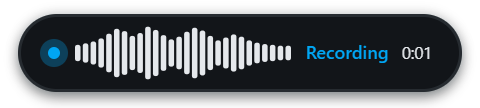
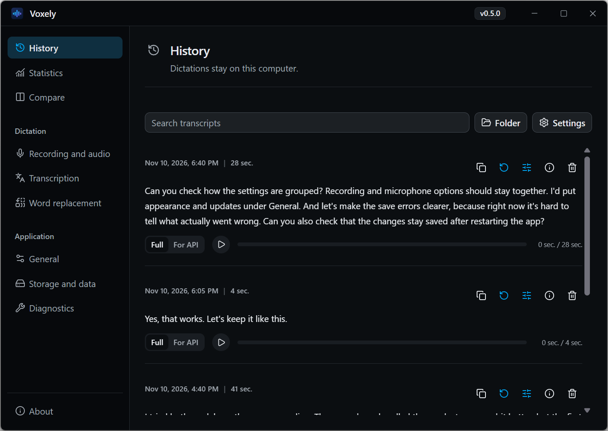
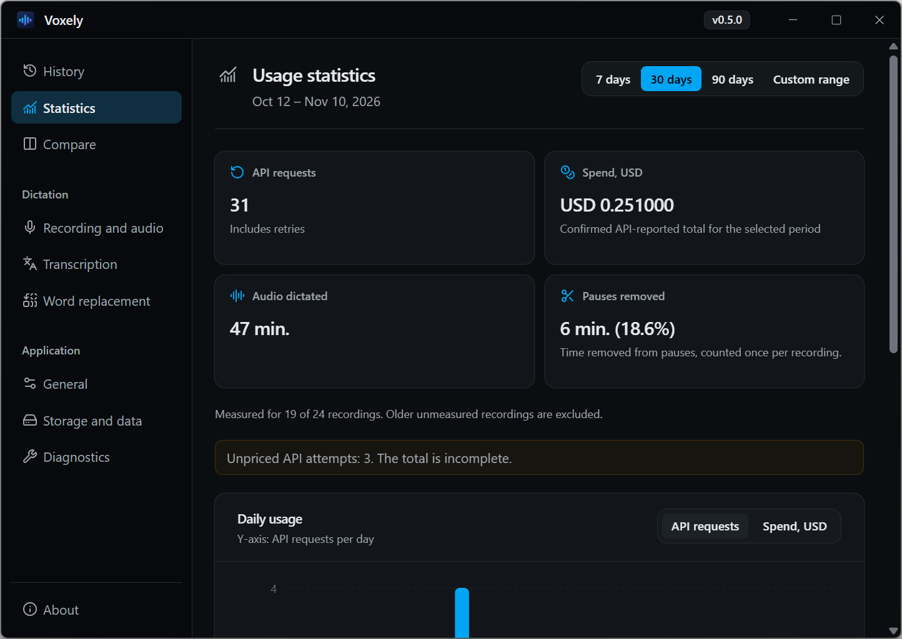
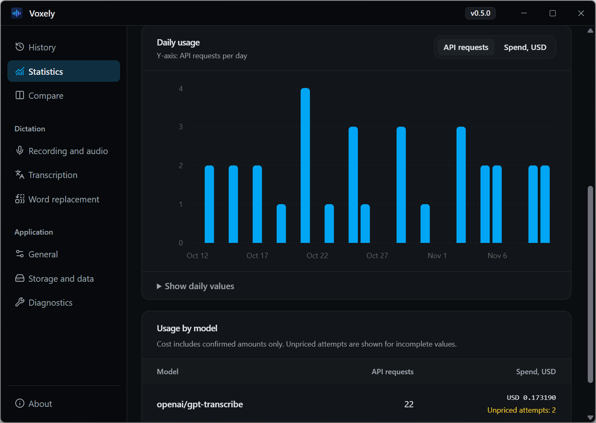
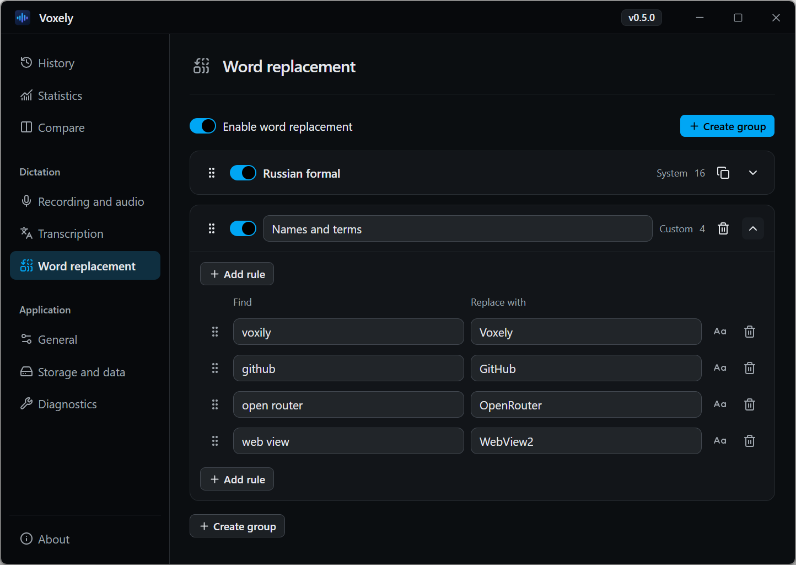
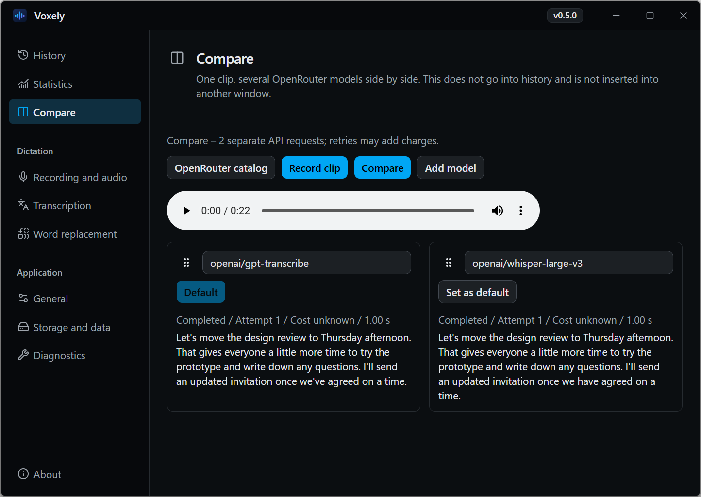
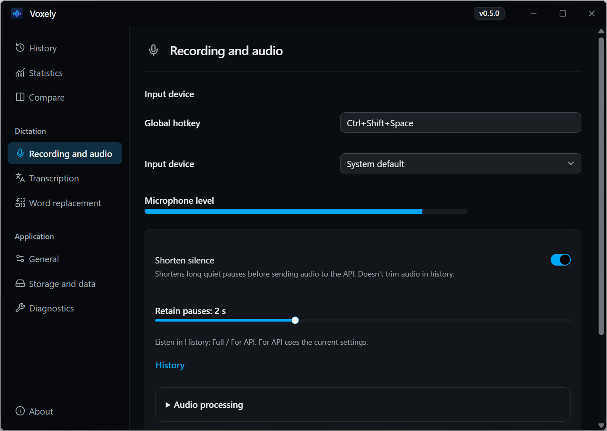

<p align="center">
  
</p>

<h1 align="center">Voxely</h1>

<p align="center">
  Voice dictation for Windows. Press a hotkey, speak, and stop recording in the window where you want your text.
</p>

<p align="center">
  <a href="https://github.com/AryaPaw/voxely/releases"></a>
  <a href="https://github.com/microsoft/winget-pkgs/tree/master/manifests/a/AryaPaw/Voxely"></a>
  <a href="https://github.com/AryaPaw/voxely/actions/workflows/verify.yml"></a>
  
  <a href="LICENSE"></a>
  
</p>

<p align="center">
  
</p>

<p align="center">
  <a href="#install">Install</a>
  &nbsp;|&nbsp;
  <a href="#features">Features</a>
  &nbsp;|&nbsp;
  <a href="#screenshots">Screenshots</a>
  &nbsp;|&nbsp;
  <a href="#privacy">Privacy</a>
  &nbsp;|&nbsp;
  <a href="#for-developers">Developers</a>
</p>

<p align="center">
  
</p>

Voxely lives in the tray and inserts transcripts into your editor, messenger, or another app. Audio is processed locally, then sent to your chosen model through OpenRouter. Transcription requires an internet connection and your own OpenRouter API key.

## Install

**Windows 11 x64**. Installs for the current user; administrator rights aren't required.

### With WinGet

```powershell
winget install -e --id AryaPaw.Voxely
```

### With the installer

Download and run the installer from the [latest release](https://github.com/AryaPaw/voxely/releases/latest). If WebView2 is missing, the installer offers to download it.

SmartScreen may warn about an unsigned installer. Tauri update signatures and Authenticode executable signing are separate mechanisms.

## Features

| Feature                   | What Voxely does                                                                                                                                                                                                                                                                   |
| ------------------------- | ---------------------------------------------------------------------------------------------------------------------------------------------------------------------------------------------------------------------------------------------------------------------------------- |
| **Dictation across apps** | A global hotkey starts and stops recording. Stopping with the hotkey selects the destination window, even if you started in another app. Repeated presses during processing don't discard your dictation.                                                                          |
| **Compact HUD**           | A recording indicator, waveform, and timer stay above other windows. Hover to cancel, or press Escape. The HUD follows the app's light or dark theme.                                                                                                                              |
| **OpenRouter models**     | A model catalog with readable names and support for custom model IDs. Configurable automatic retries and timeouts handle temporary provider failures.                                                                                                                              |
| **Local history**         | Search transcripts, copy text, play recordings, and retry transcription. Set retention periods and a storage limit in gigabytes.                                                                                                                                                   |
| **Shorter pauses**        | Long quiet sections are shortened before audio is sent to the API. You can disable this in recording settings. In History, **Full / For API** switches between the original recording and the prepared version; full audio is retained when original recording storage is enabled. |
| **Audio processing**      | Low-frequency rumble filtering, gain, noise reduction, compressor, expander, gate, and limiter. Choose presets, reorder processing steps, and listen to original and processed samples.                                                                                            |
| **Word replacement**      | Built-in presets are updated with the app, including formal Russian forms of address. Create, edit, enable, and disable your own groups of replacement rules.                                                                                                                      |
| **Model comparison**      | Send one recording to several models and view their transcripts side by side to compare accuracy, names, and response times.                                                                                                                                                       |
| **90-day statistics**     | API requests including retries, confirmed USD spend, audio duration, and time saved by shortening pauses. View request or spend charts, model breakdowns, 7 / 30 / 90-day periods, and custom ranges. Unknown costs are marked rather than estimated.                              |
| **Appearance**            | Light, dark, and system themes, accent colors and shades, and a reset to the default Sky color. English and Russian UI. Reset the window size in **General**.                                                                                                                      |
| **Settings transfer**     | Import and export settings, presets, and replacement rules. The API key isn't included in exports.                                                                                                                                                                                 |
| **Updates**               | Automatic update checks and manual installation from GitHub Releases, with Tauri signature verification.                                                                                                                                                                           |

## Getting started

1. Open **Transcription**, add your [OpenRouter API key](https://openrouter.ai/), and test the connection. Choose a model from the catalog or enter its ID.
2. Switch to your target app and press **Ctrl+Shift+Space**. Change the hotkey in **Recording and audio**.
3. Speak. The HUD shows the audio level and recording time.
4. Place the cursor in the destination field and press the hotkey again. Voxely transcribes your recording and inserts the text through Unicode input.
5. Open **History** whenever you need to copy text, listen to a recording, or retry transcription.

If the destination becomes unavailable or focus changes before insertion, the transcript stays in History and the app reports that it was copied to the clipboard. Stopping from Voxely itself or reaching the automatic recording limit keeps the window selected at recording start. The app doesn't send Ctrl+V.

## Screenshots

Real Tauri/WebView2 windows at the default **960×680** size, with English UI and fictional demo data. All main screenshots use the same Windows display scale; the HUD above is captured separately at its compact size.

### Usage statistics

<p align="center">
  
</p>

The chart and model breakdown further down the same page:

<p align="center">
  
</p>

### Word replacement groups

<p align="center">
  
</p>

### Model comparison

<p align="center">
  
</p>

### Recording and audio processing

<p align="center">
  
</p>

## Privacy

- Your API key stays in Windows Credential Manager and isn't included in settings exports.
- History and audio are stored locally in `%APPDATA%\Voxely`. Configure retention and storage limits in **Storage and data**.
- Prepared audio is sent to OpenRouter and the selected provider for transcription. Speech recognition isn't fully offline.
- Statistics are stored separately for up to 90 days and contain metadata without transcripts, audio, or file paths. Automatic history cleanup doesn't remove these metrics early. Manually deleting a dictation removes its metrics; clearing all history also clears statistics.

Read more: [Security](docs/SECURITY.md), [OpenRouter](docs/OPENROUTER.md), [Diagnostics](docs/DIAGNOSTICS.md).

## For developers

Built with **Tauri 2, Rust, React, TypeScript, shadcn/ui, and Tailwind CSS**. Tool versions are pinned in `rust-toolchain.toml` and the `packageManager` field in `package.json`. Windows development requires Visual Studio Build Tools with C++ and WebView2.

```powershell
bun install --frozen-lockfile
bun run --bun tauri dev
```

Run the full automated verification:

```powershell
bun run --bun verify
```

### Refresh screenshots with one command

```powershell
bun run --bun docs:shots
```

The command builds an isolated fixture from the current React components, opens real Tauri windows, and captures the entire series through Windows Graphics Capture. The main window size comes from `src-tauri/tauri.conf.json`. Once every capture passes validation, images in `docs/images` are replaced. A publication failure restores the previous series.

An interactive Windows desktop with WebView2 is required. Administrator rights aren't needed; a restricted terminal sandbox may block the system capture API. The fixture uses a separate profile, synthetic audio, and demo transcripts. It doesn't launch your daily-driver Voxely, record the microphone, send API requests, or read your history or API key.

To capture only a pilot without replacing README images:

```powershell
bun run --bun docs:shots --pilot
```

Scenes are listed in `scripts/readme-shots/scenes.json`; demo data lives in `scripts/readme-shots/tauri-core.ts`. The terminal prints the output and log paths. Results are archived locally; temporary profiles and fixture assets are removed after archive verification. The three most recent archived runs are retained.

[Architecture](docs/ARCHITECTURE.md) | [Testing](docs/TESTING.md) | [Releases](docs/RELEASE.md) | [WinGet](docs/WINGET.md)

## License

[AGPL-3.0](LICENSE).
